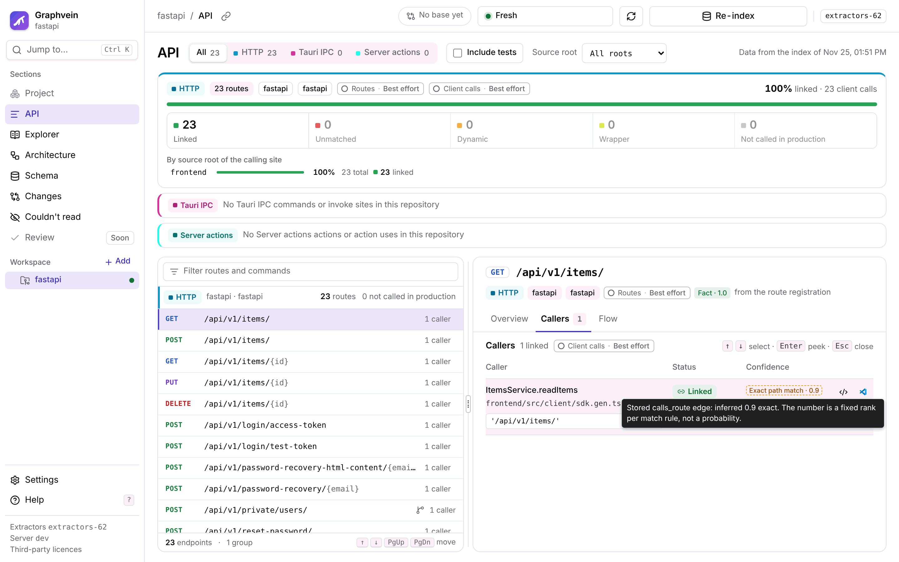
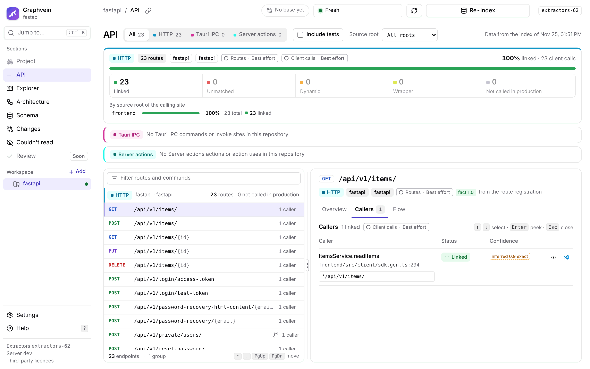

# Graphvein

<!-- site:lead -->
**Trace any route, call or table across your stack.**

Frontend calls behind a route, its handler, the tables it may read or
write, and what a change reaches.
<!-- /site:lead -->

Graphvein maps a codebase from its architecture overview down to the exact
function or line. It builds a deterministic graph of code facts and keeps
design rationale, assessments and human decisions attached to the code they
describe.

## Status

<!-- site:status -->
**Preview release (v0.1.0); contributions welcome** under the contributor licence agreement ([CONTRIBUTING.md](CONTRIBUTING.md)). What works today:
`graphvein index` builds the index of a repository, and `graphvein serve`
opens a local web UI on it with the sections API (routes and their
callers), Changes (what a change reaches), Architecture, Schema, Explorer
(API documentation and a guarded "Try it out"), Project and What Graphvein
couldn't read. Two or more repositories can be indexed and served as one
project, and `graphvein mcp` is a read-only MCP server over the same index
for coding agents. Help in the app explains every section and label
([guide](docs/guide/1-start-here.md)). What Graphvein does not see or
model today is listed in [known gaps](docs/known-gaps.md).
<!-- /site:status -->

<p>
  
  
</p>

The same route of the public
[full-stack FastAPI template](https://github.com/fastapi/full-stack-fastapi-template)
in the plain label style with the caller's tooltip open (left), and in
the technical style (right). The number is a fixed rank per match rule,
not a probability.

<!-- site:status-table -->
| Area | What is read | Measured evidence |
|---|---|---|
| Routes and their callers | Routes: Express, FastAPI, Axum, Go `net/http`, chi and gin, Next.js App Router, Angular and Tauri commands. Calls: `fetch`, axios, Angular `HttpClient`, hey-api and Orval generated clients and the Supabase JS client ([routes](docs/extract/routes.md), [clients](docs/extract/clients.md)). | Route-to-caller links on three messy open-source repositories (langflow, owncast, seerr): 363 of 363 links correct in the current state, after the fix of the 22 false links the first measurement found and its follow-ups, precision 100.0% [Wilson 95%: 99.0%, 100.0%] (first measurement 94.6%). Recall in application code: 93.0% (langflow) and 93.5% (seerr); owncast reaches 81.5% of the calls Graphvein recognises, but its admin console calls the API through a `fetchData` helper that Graphvein does not recognise yet. Counting every call, langflow's falls to 27.8%: its documentation examples pass the HTTP method in a `fetch` options object and take the base URL from `process.env`, which Graphvein does not resolve yet ([link precision](docs/evidence/link-precision.md#recall-in-application-code)). |
| TypeScript and JavaScript call binding | Calls to functions, classes and object members by name, with static dispatch; a call Graphvein cannot bind stays unresolved ([TypeScript resolution](docs/lang/typescript-resolution.md)). | 0 wrong call edges against the language's own scope analysis on 12 corpora: 11 public open-source repositories and Graphvein's own web UI ([call binding](docs/evidence/call-binding.md)). |
| Schema | SQL migrations, judged under Postgres rules; models of SQLModel, Prisma, Drizzle, Sequelize, TypeORM, Diesel and GORM; Supabase generated types ([schema](docs/extract/schema.md)). | Where an oracle harness exists, facts are compared with the catalog of a real database, and a fact is marked checked only for a form the oracle compared. MySQL, SQL Server and CockroachDB facts are mapped, not checked ([known gaps](docs/known-gaps.md#schema)). |
| Project linking | Calls in one repository linked to routes in another, labelled inferred with the assumption they rest on; a call several members could serve stays ambiguous until a `consumes` declaration settles it ([project](docs/cli/project.md)). | No separate measurement yet ([known gaps](docs/known-gaps.md#project-mode)). |
| MCP server | Read-only tools for routes, callers, call chains, tables, change impact, search and source over the index ([mcp](docs/cli/mcp.md)). | Benchmark of 21 questions, three agents, three repetitions each: correct runs out of 63 rose from 53 to 62 (Claude Code) and from 56 to 61 (opencode) with the MCP server; Codex was at 59 without it and 59 to 61 with it, within run-to-run variation. Round 3: with new server instructions, default Codex called Graphvein's tools in 26 of 63 runs, against 2 of 63 before ([results](docs/evidence/benchmark/results-2026-11-24.md#round-3)). |

Calls Graphvein cannot link are not hidden: the API section counts them
as unmatched, dynamic or behind a wrapper, and selecting a count lists the
calls behind it.
<!-- /site:status-table -->

## Install

Each [release](https://github.com/graphvein/graphvein/releases/latest)
has one archive per system (Windows, macOS and Linux, each for x86-64 and
Arm64): `.zip` for Windows, `.tar.gz` for macOS and Linux. Each archive
holds the `graphvein` binary with `LICENSE`, `NOTICE`,
`THIRD_PARTY_NOTICES` and this README. The binaries are built by the
[release workflow](.github/workflows/release.yml) from the release tag;
they are not code-signed. Download the archive for your system and
`SHA256SUMS` from the release page, then check them.

**Checksum.** In the download folder (Git Bash on Windows has
`sha256sum`; on macOS use `shasum -a 256 -c` in its place):

```bash
grep graphvein-v0.1.0-linux-amd64.tar.gz SHA256SUMS | sha256sum -c
```

**Provenance.** Each archive has a build provenance attestation that ties
it to the workflow run and the commit it was built from. With the
[GitHub CLI](https://cli.github.com/):

```bash
gh attestation verify graphvein-v0.1.0-linux-amd64.tar.gz --repo graphvein/graphvein
```

Unpack it (`tar -xzf graphvein-v0.1.0-linux-amd64.tar.gz`; on Windows,
Extract All in File Explorer) and put the folder on your `PATH`, or call
the binary by its path: `graphvein version` prints the version you
downloaded.

**First run on Windows.** A downloaded program that is not code-signed
can make SmartScreen show "Windows protected your PC". Choose **More
info**, then **Run anyway**. Or, before unpacking, open the `.zip` file's
**Properties** and tick **Unblock**.

**First run on macOS.** Gatekeeper refuses a downloaded binary that is
not notarised ("graphvein" Not Opened, or "cannot be opened because Apple
cannot check it for malicious software"). Remove the download mark from
the unpacked binary:

```bash
xattr -d com.apple.quarantine ./graphvein
```

or try to run it once, then open **System Settings → Privacy & Security**
and choose **Open Anyway** next to the message about `graphvein`.

**Without warnings: install with Go.** A binary you build yourself
carries no download mark, so neither warning appears:

```bash
go install github.com/graphvein/graphvein/cmd/graphvein@latest
```

It needs Go 1.21 or newer, which downloads the Go toolchain the module
requires when yours is older. The binary goes to `$(go env GOPATH)/bin`
and `graphvein version` reports the module version you installed (use
`@v0.1.0` for a given release). To build from a checkout instead, see the
next section.

## Building and running

Requires Go **1.27.4** (the `toolchain` line in `go.mod`; an installed Go 1.21 or
newer downloads it automatically) and Bash (Git Bash on Windows). No C
compiler is needed.
From the repository root:

```bash
bash scripts/test.sh
bash scripts/build.sh
./bin/graphvein$(go env GOEXE) version
./bin/graphvein$(go env GOEXE) help
```

`graphvein serve [path]` serves the local web UI and HTTP API for an indexed
repository at `http://127.0.0.1:7420/` (loopback only; see
[serve](docs/cli/serve.md)). The UI is embedded in the binary, so building and
testing need only Go. Node (24 LTS, pinned in `web/.nvmrc`) is needed only to
change the UI: see [web/README.md](web/README.md) and run
`bash scripts/check-web.sh` after editing `web/`.

### Two repositories as one project

A frontend and a backend kept in separate repositories can be indexed,
linked and served together (ADR 0075, [project](docs/cli/project.md)).
With the built binary on your `PATH`, from the folder that holds both
checkouts (`shop-web`, `shop-api`):

```bash
graphvein project init --name shop --dir shop frontend=shop-web backend=shop-api
graphvein index --project shop
graphvein serve --project shop
```

Each member is named explicitly (`NAME=PATH`, unless its own
`graphvein.yaml` sets `repository:`), and its path is written relative to
the manifest.

`project init` writes `graphvein-project.yaml`; `index --project` indexes
each member into the project store (`.graphvein/index.db` next to the
manifest) and links calls in one repository to routes in the other;
`serve --project` serves the UI at `http://127.0.0.1:7420/` with a
repository switcher and the Project view. A cross-repository link is
`inferred` and shows the assumption it rests on; when several members
could serve a call it stays ambiguous until you declare which one it
`consumes` (Edit declarations in the Project view, or
`graphvein project suggest`). `graphvein status --project .` reports
member freshness and stale links.

The build writes `bin/graphvein.exe` on Windows and `bin/graphvein` elsewhere.
`VERSION` (default `dev`) and `BUILD_DATE` (default current UTC time) can override
build metadata; the commit comes from Git, falling back to `unknown`.
A version left at `dev` is replaced by the module version the Go toolchain
recorded, if any (`go build` in a Git checkout records a version from the
commit; `go install ...@v0.1.0` records `v0.1.0`), and an unknown commit or
date by the Git commit and its time the toolchain recorded.
Direct `go run ./cmd/graphvein version` uses `dev` / `unknown` / `unknown`.
`bash scripts/release-archives.sh VERSION OUTDIR` builds the release
archives and `SHA256SUMS` as the release workflow does.

Tests include the golden harness self-tests. Fixture tests call
`golden.Check(t, "testdata/name.golden.json", value)`. Use `golden.Path` for
filesystem path fields; ordinary text strings are preserved. Object keys are
sorted, arrays keep their input order, and output uses two spaces and LF.
A mismatch names the first JSON path with expected and actual values.
To intentionally update only selected fixtures, review the resulting diff:

```bash
go test ./internal/golden -run '^TestFixture$' -update
```

The isolated parsing spike retains its own module and tests:

```bash
(cd spike/parsing && CGO_ENABLED=0 go test ./...)
```

CI runs the main module on Windows, macOS and Linux with cgo disabled, and the
WASM spike tests on Windows. `bash scripts/check-line-endings.sh` checks tracked
files for CRLF, respecting binary attributes and Windows script exceptions.
See [the vision](docs/VISION.md), [architecture](docs/ARCHITECTURE.md) and
[roadmap](ROADMAP.md) for scope and order, and [known gaps](docs/known-gaps.md)
for what Graphvein does not see or model today.

## Licence, contributing and security

Graphvein is licensed under the [Apache License 2.0](LICENSE); see
[NOTICE](NOTICE) for the copyright notice and the bundled editor logos,
which stay under their owners' terms, and
[THIRD_PARTY_NOTICES](THIRD_PARTY_NOTICES) for third-party software.
Contributions need a signed contributor licence agreement; see
[CONTRIBUTING.md](CONTRIBUTING.md). Report vulnerabilities privately as
described in [SECURITY.md](SECURITY.md). Everyone taking part follows the
[code of conduct](CODE_OF_CONDUCT.md).

<!-- site:trademark -->
Graphvein™ is a trademark of the project owner. The Apache License does
not grant permission to use the name; forks must use a different name.
<!-- /site:trademark -->
